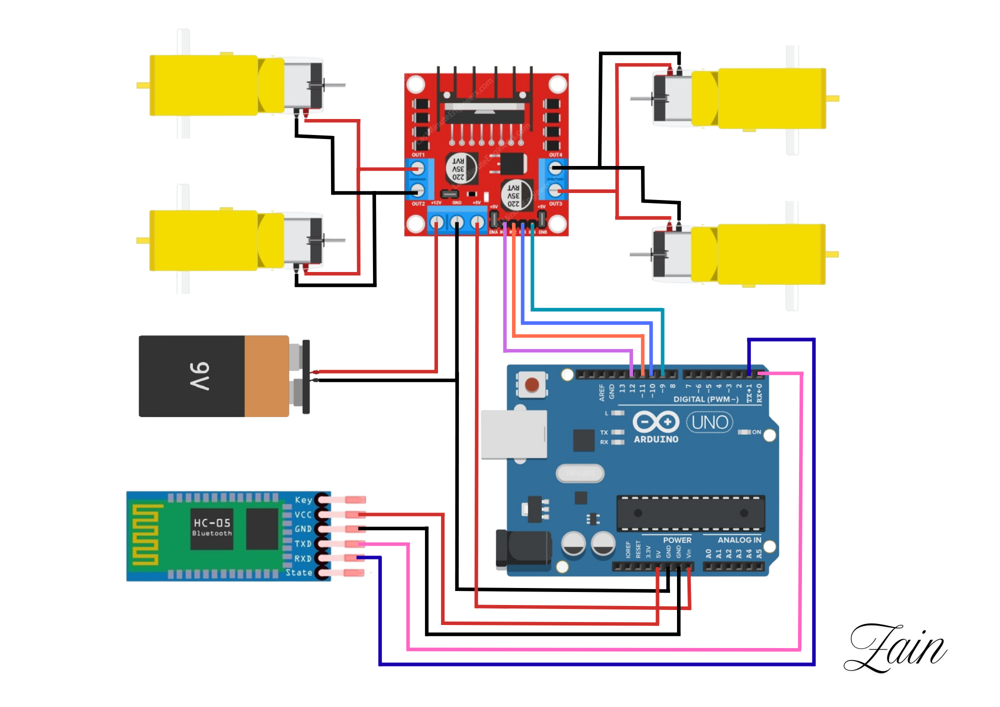

# Aurdino-RC-car-
A aurdino robot car with chasis frame and 4 hobby motors , l2098n motor driver and a hc05 module
Components needed:
1. Aurdino Uno 
2. HC-o5 bluetooth module
3. L298N motor driver
4. battery
5. Car chasis 
## Circuit Diagram

  

If you want to power everything from one battery connect the 5v pin of the l298n to the 5v pin of the aurdino 
